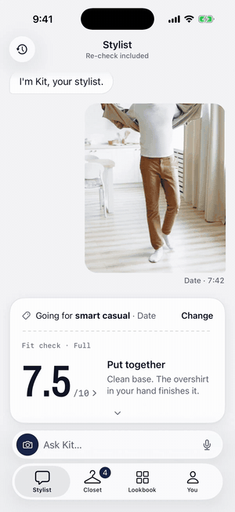
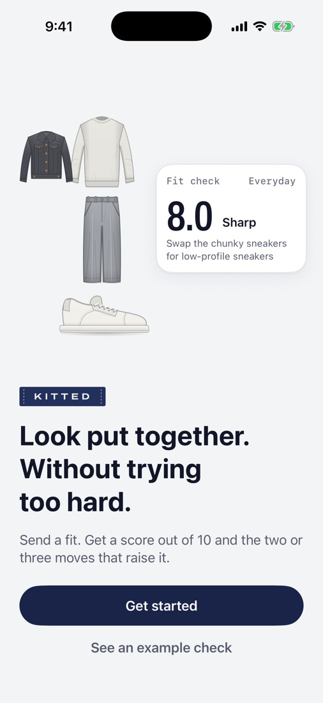
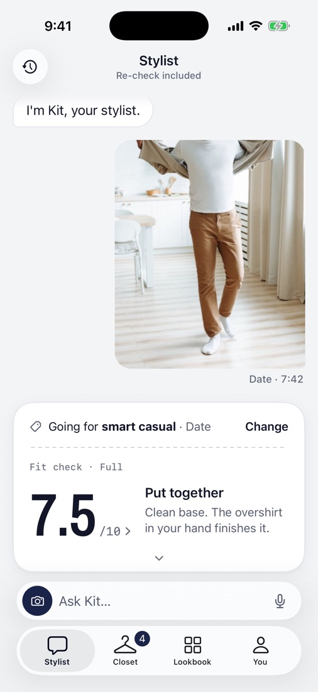
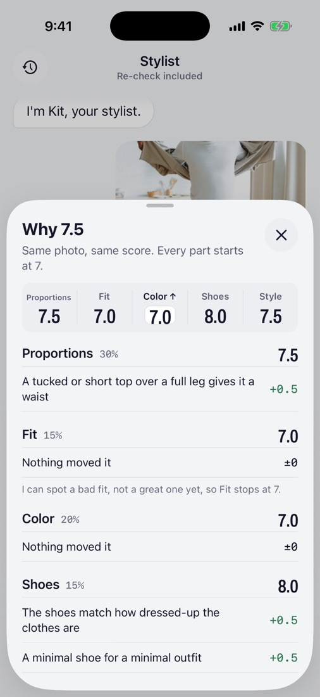
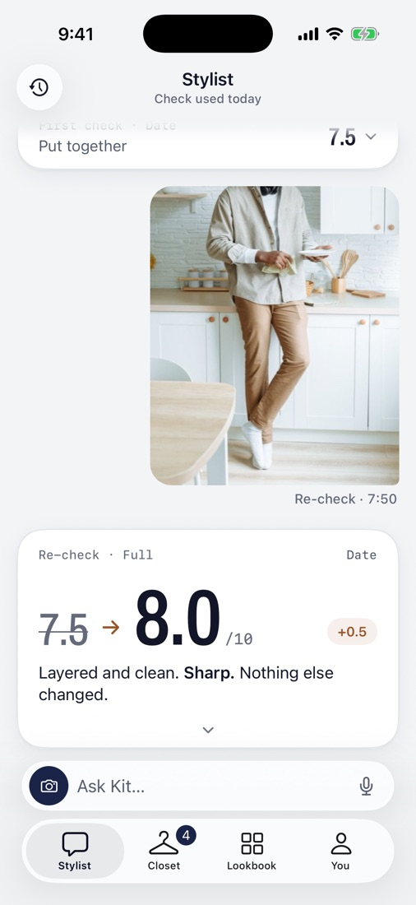
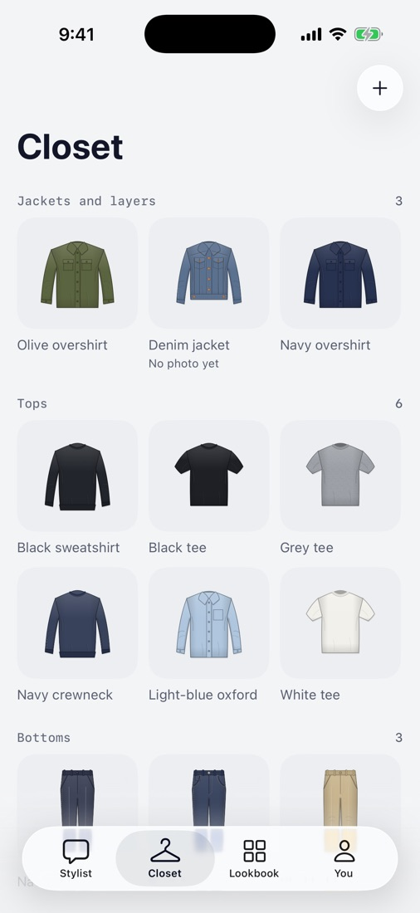

# Kitted

Send an outfit photo, get a fit score out of 10 with one word for it, and the one fix that raises it. The app learns your closet as you go.

An iOS app for guys 18 to 30, built solo by Eyu Haile since October 2026: React Native and Expo on the phone, a Python-designed scoring engine ported to TypeScript, and a Firebase server for the AI calls.

**[Try the web demo](https://eyualem.github.io/kitted/)**: the real app's code running in your browser with scripted demo data (no account, no AI calls).

<p>
  
</p>

| Welcome | Fit check | Why this score | Re-check | Closet |
| --- | --- | --- | --- | --- |
|  |  |  |  |  |

Screenshots from the iOS Simulator (iPhone 17 Pro). Outfit photos are free-license stock; see [Photo credits](#photo-credits).

## How it's built

### The AI sees, the code judges, the AI explains

The core design rule. A vision model is good at describing clothes and bad at being consistent about taste, so the work is split:

1. **The AI sees.** The vision model fills in a fixed schema: each piece, its color, fit, length and how it's worn. It never gives a score.
2. **The code judges.** A deterministic engine turns that description into the score and picks the fix. Same photo, same description, same score.
3. **The AI explains.** The model only puts the code's verdict into words, as Kit, the app's stylist persona.

Because the judging is code, every rule change can be re-run against saved readings for free, without new AI calls.

### One engine, two languages

The scoring rules were designed and tuned in Python ([`extraction-test/`](extraction-test/), with the rules in plain words in [`rubric/`](rubric/)), then ported to TypeScript as [`@kitted/core`](app/packages/kitted-core/). Thousands of parity tests run both on the same fixtures and fail on any difference, so the phone always scores exactly as the reference engine does.

### Privacy by construction

- Faces are found and blurred on the phone (Apple's Vision framework, in a native Swift module, [`app/modules/kitted-vision`](app/modules/kitted-vision/)) before anything leaves it. If the head can't be found, nothing is sent.
- The server keeps no photos, questions or answers. Location is approximate, used for the weather only, and never stored.
- The app never rates faces, bodies or skin, only clothes.

### The pieces

| Part | Stack | Where |
| --- | --- | --- |
| iOS app | React Native, Expo SDK 57, TypeScript, Expo Router, SQLite, Reanimated | [`app/`](app/) |
| Scoring engine | TypeScript, Vitest; parity-tested against the Python reference | [`app/packages/kitted-core/`](app/packages/kitted-core/) |
| Reference engine and vision tests | Python | [`extraction-test/`](extraction-test/) |
| Server | Firebase Cloud Functions, Firestore, security rules; per-user daily limits and a global spend cap | [`firebase/`](firebase/) |
| Web demo | The app's demo screens exported for the web, on GitHub Pages | [`site/`](site/), [`.github/workflows/pages.yml`](.github/workflows/pages.yml) |

### How the work is run

Every feature starts as a written spec with pass/fail checks ([`specs/`](specs/)), before any code. Each task is sized to its risk: small changes ship alone with a test; normal ones get a separate review; scoring, privacy and the age gate are test-first, with the tests written and locked before the code and a reviewer that plants bugs to prove the tests catch them. Every decision and lesson is logged with its reason in [`handoff/DECISIONS-LOG.md`](handoff/DECISIONS-LOG.md), and each task keeps its plan, screenshots and review in [`tasks/`](tasks/).

I build with Claude Code as a pair programmer (you'll see it as a co-author on commits). The product, the scoring design, the specs and the process are mine; the workflow rules it follows are in [`CLAUDE.md`](CLAUDE.md).

## Running it

Needs Node 22 and, for iOS, Xcode with the iOS Simulator.

```sh
cd app
npm install
npm run web      # the demo screens in a browser: http://localhost:8081/demo
npm run check    # typecheck, lint, the scoring parity tests and the app tests
```

The iOS build and the live AI features need private keys and a Firebase project that aren't in this repo, so a fresh clone runs the demo mode only.

## Status

In active development and not yet on the App Store; a TestFlight beta with friends comes next. [`plan.md`](plan.md) has the live state.

## License

Copyright (c) 2026 Eyu Haile. All rights reserved. The source is public so it can be read and reviewed; it is not licensed for reuse. See [LICENSE](LICENSE).

## Photo credits

The demo's outfit photos are free-license stock (Unsplash and Pexels licenses):

| File | Photographer | Source |
| --- | --- | --- |
| p01a, p01b | Thirdman | [Pexels](https://www.pexels.com/photo/photo-of-a-man-in-a-white-shirt-taking-off-his-jacket-7237042/), [Pexels](https://www.pexels.com/photo/photo-of-a-man-in-brown-pants-cleaning-a-plate-7237029/) |
| s05 | Adele Shafiee | [Unsplash](https://unsplash.com/photos/a-person-standing-in-front-of-a-stone-wall-pYJgD_sQRGQ) |
| s09 | Mohamad Khosravi | [Unsplash](https://unsplash.com/photos/man-in-blue-suit-standing-on-sidewalk-during-daytime--eb0moHDPBI) |
| s10 | Raviraj Singh Tomar | [Unsplash](https://unsplash.com/photos/a-man-walking-down-a-sidewalk-in-front-of-a-store-IuMSyLBGRGE) |
| s12 | Eddie Wingertsahn | [Unsplash](https://unsplash.com/photos/a-man-standing-in-the-dark-with-a-cell-phone-Eh7PCY708tM) |
| s13 | Olek Buzunov | [Unsplash](https://unsplash.com/photos/man-in-embroidered-shirt-on-sidewalk-umGrs1QVJ38) |
| s14, s15 | Babak Eshaghian | [Unsplash](https://unsplash.com/photos/man-walking-on-a-path-in-a-park-43SxbLawFig), [Unsplash](https://unsplash.com/photos/man-walking-down-orange-stairs-with-blue-railing-RUSAfuw_h9w) |
| s22 | Mohammad Al Jannat Rakin | [Unsplash](https://unsplash.com/photos/man-in-brown-polo-shirt-G6HKzNkRkcM) |
| s24 | Nick Dunlap | [Unsplash](https://unsplash.com/photos/woman-in-brown-jacket-taking-photo-in-front-of-mirror-Dz0hHg7tOdM) |
| s25 | Les Taylor | [Unsplash](https://unsplash.com/photos/man-taking-a-selfie-in-a-mirror-with-camera-fJklDSftytk) |

The Archivo fonts are under the SIL Open Font License ([`app/assets/fonts/OFL.txt`](app/assets/fonts/OFL.txt)).
