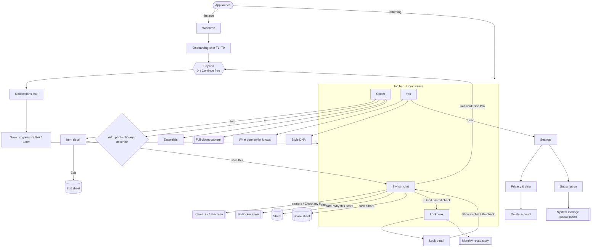
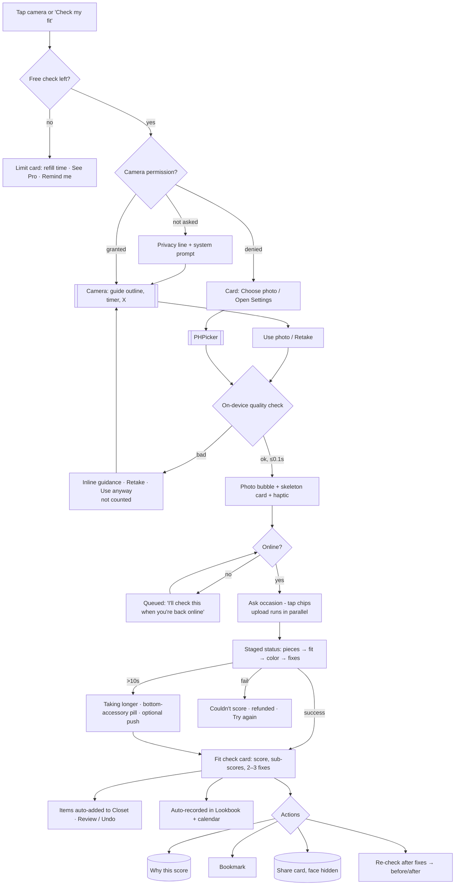

# 03 — Information Architecture & UX Spec

*Role: IA & UX designer. Input: research-context.md (A1–A5, C2, C12–C14). All locked decisions are respected. Where I recommend changing a **proposed** item (tab names, A4 order), it is marked **[Recommendation]**. v1 = launch, v1.1 = first update (about 4–6 weeks after launch), v2 = later.*

**Design principle for "never feels complicated":** *one place to do things (Stylist), three places to look at things (Closet, Lookbook, You).* Every action that creates something (fit check, outfit idea, new item, question) starts in or returns to the chat. Browsing tabs never contain their own chat. That one rule removes most of the "where do I go?" confusion.

---

## 1. Navigation model

### 1.1 Tab evaluation

| Option | Tabs | Verdict |
|---|---|---|
| **A (recommended)** | **Stylist · Closet · Lookbook · You** | Keep. 4 labeled tabs sits inside the HIG's 3–5 range. Each tab answers one question: *talk* / *what I own* / *what I've worn and how I'm improving* / *who I am and my settings*. |
| B | Stylist · Closet · You (Lookbook inside You) | Simpler, but it hides history and the monthly recap. Those are the "visible progress" differentiator and the source of share cards. Rejected. |
| C | Today (dashboard) · Stylist · Closet · You | The dashboard duplicates what the chat's quick-starts already do, and gives two "homes." Rejected. |
| D | Center "+" camera tab | A tab used as an action breaks C14 and the HIG. Rejected. The camera is the biggest button in the composer instead. |

**Naming notes:** "Lookbook" fits fashion and stays clear when paired with a photo-stack icon. If beginner testing confuses people, fall back to "Looks." "You" is a known pattern (YouTube) and shorter than "Profile." Avoid the `sparkles` symbol for Stylist, since it signals "AI" and A3 wants the AI to be less in your face. Suggested SF Symbols: `bubble.left.and.text.bubble.right` (Stylist), `hanger` (Closet), `photo.stack` (Lookbook), `person.crop.circle` (You).

### 1.2 iOS 26 tab bar behavior
- **Floating Liquid Glass tab bar.** No custom tab bar; the system one gives Jakob's-Law familiarity for free ([HIG Tab bars](https://developer.apple.com/design/human-interface-guidelines/tab-bars), [WWDC25 "Build a SwiftUI app with the new design"](https://nonstrict.eu/wwdcindex/wwdc2025/323/)).
- **Minimize on scroll** (`tabBarMinimizeBehavior(.onScrollDown)`) in Closet and Lookbook, where grids are long. In Stylist the tab bar stays fixed so the composer never jumps. Test the inverted-scroll chat carefully.
- **Bottom accessory** ([createwithswift](https://www.createwithswift.com/enhancing-the-tab-bar-with-a-bottom-accessory/)) is for *ongoing state*, not actions. We use it in only one case: **"Scoring your fit… ·  tap to view"** while a fit check is processing and the user has switched tabs. It disappears when the result lands. It is not a persistent "Check my fit" button, because that would be an action.
- **No Search tab in v1.** Closet gets `.searchable` once it has 20+ items. A global search tab (role `.search`) is a v2 option if Lookbook + Closet grow large.
- **Launch behavior:** restore the last tab, as iOS apps normally do. Deep links (notifications, widgets) go straight to their target. The very first launch after onboarding lands on Stylist.
- **Hide the tab bar** during onboarding, camera, paywall, full-closet capture and the monthly recap story (all full-screen covers).

### 1.3 Presentation rules (applied everywhere)
| Use | When | Exit |
|---|---|---|
| **Push** | Drilling into an object (item, look, setting) | Back chevron + edge swipe |
| **Sheet** (medium/large detents) | Short task or explanation that keeps context (edit item, "Why this score", add-item menu) | Swipe down + "Done"/X. If there are unsaved edits, swipe-down asks "Discard changes?" |
| **Full-screen cover** | Immersive or focused flows (camera, paywall, onboarding, recap, full-closet capture) | Always a visible X (top-left) **from the first frame**. No delayed X on the paywall. |
| **Alert / confirmation dialog** | Only for destructive, irreversible actions (delete account, delete all photos) | Cancel is the default button |
| **Undo toast** | Reversible deletes (one fact, one item, auto-added item) | 5 s undo. No alert needed. |

**Cross-tab rule:** "Style this item," "Ask about this look," and "Re-check" from Closet/Lookbook **switch to the Stylist tab** and post a context card (thumbnail + "About this navy overshirt…"). The chat exists in exactly one place.

### 1.4 Full screen inventory

| # | Screen | Tab / origin | Presentation | Exit | Ver |
|---|---|---|---|---|---|
| **Onboarding** |||||
| O1 | Welcome | Cold start | Full-screen cover (root) | n/a; "Get started" → O2 | v1 |
| O2 | Onboarding chat (turns T1–T12) | O1 | Same cover, chat layout | Back chevron = undo last answer. No X (finish or force-quit; it resumes, see §3.4) | v1 |
| O3 | Height picker | O2 T3 | Sheet (medium) | Done / swipe | v1 |
| O4 | Restore account (Sign in with Apple) | O1 "I have an account" | System sheet | Cancel | v1 |
| **Stylist** |||||
| S1 | Chat thread | Tab root | — | — | v1 |
| S2 | Camera (fit check / item) | Composer camera, "Check my fit" chip | Full-screen cover | X top-left, swipe down | v1 |
| S3 | Photo review ("Use photo / Retake") | S2 | Inside S2 | Retake / X | v1 |
| S4 | Photo library picker (PHPicker) | Composer photo button | System sheet | Cancel | v1 |
| S5 | Photo viewer (zoom) | Tap any photo in a card | Full-screen cover, zoom transition | X / swipe down | v1 |
| S6 | Why this score | Card action | Sheet (medium → large) | Swipe / Done | v1 |
| S7 | Share card composer | Card action | Sheet (large): preview, "Hide face" toggle, format (story/square), system share | X / after share | v1 |
| S8 | Before/after compare | "Re-check" result card | Push-like full-screen cover | X | v1.1 |
| S9 | Item quick-edit (from a detected-item chip) | Card chip | Sheet (medium) | Done / swipe | v1 |
| S10 | Free-limit card → Pro | Inline card → P1 | Inline, then full-screen cover | — | v1 |
| S11 | Chat overflow menu (… top-right): *Find a past fit check* → Lookbook, *What I know about you* → Y3 | Nav bar | Menu | Tap outside | v1 |
| **Closet** |||||
| C1 | Closet home: header stats (rotation, essentials) + category segments + grid | Tab root | — | — | v1 |
| C2 | Item detail | C1 grid | Push | Back | v1 |
| C3 | Edit item | C2 "Edit" | Sheet (large) | Cancel/Save | v1 |
| C4 | Add item menu: Take photo / Choose photos / Describe it | C1 "+" (top-right) | Menu → S2 / S4 / text sheet | — | v1 |
| C5 | Starter essentials checklist | C1 header card | Push | Back | v1 |
| C6 | Rotation explainer ("How 37 fits is counted") | Tap rotation number | Sheet (medium) | Swipe | v1 |
| C7 | Full-closet capture (multi-shot, review queue) | C1 card / onboarding choice | Full-screen cover | X (progress saved) | v1 |
| C8 | Gaps ("Biggest wins to buy next") | C1 header | Push | Back | v1.1 |
| C9 | Cost per wear / Forgotten items | C1 header | Push | Back | v2 |
| **Lookbook** |||||
| L1 | Lookbook home: segmented **Looks · Calendar · Recaps** | Tab root | — | — | v1 |
| L2 | Look detail (photo, score, fixes, items worn, "Show in chat") | L1 | Push | Back | v1 |
| L3 | Month calendar (days dressed with intent) | L1 segment | Inline | — | v1 |
| L4 | Monthly recap story | L1 Recaps / notification | Full-screen cover (paged) | X / swipe down | v1 |
| L5 | Saved outfit ideas (filter) | L1 filter chip | Inline filter | — | v1 |
| **You** |||||
| Y1 | You home: silhouette, Style DNA, streak, Pro row, "What your stylist knows" | Tab root | — | — | v1 |
| Y2 | Style profile (goals, styles, boldness, budget, basics) | Y1 | Push → row edit sheets | Back | v1 |
| Y3 | What your stylist knows | Y1 / S11 | Push | Back | v1 |
| Y4 | Style DNA detail | Y1 | Push | Back | v1 (unlocks at 3 checks) |
| Y5 | Settings | Gear (top-right) | Push | Back | v1 |
| Y6 | Privacy & data | Y5 | Push | Back | v1 |
| Y7 | Delete account flow | Y6 | Push → confirm dialog | Cancel | v1 |
| Y8 | Subscription | Y1 Pro row / Y5 | Push → system `manageSubscriptionsSheet` | Back | v1 |
| Y9 | Notifications settings | Y5 | Push | Back | v1 |
| **Global** |||||
| P1 | Paywall | Onboarding T10, limit card, Pro row | Full-screen cover | X top-left + "Continue free" | v1 |
| G1 | Offline banner | Any | Inline banner under nav bar | Auto-hides | v1 |

---

## 2. The chat screen (S1) in detail

### 2.1 Layout (top to bottom)
1. **Nav bar:** inline title "Stylist," trailing `…` menu (S11). No gear here; settings live only in You.
2. **Thread:** one continuous conversation (like Messages). Day separators ("Today," "Mon Oct 5"). The onboarding conversation is the start of this thread, so the first real chat feels continuous.
3. **Suggestion chips** (above the composer): the 4 quick-starts when idle. After each reply they change to ≤3 contextual next steps ("Re-check after fixes," "What shoes go with this?"). Chips hide while typing.
4. **Composer:** `[camera] [photos] [ Ask your stylist… ] [send]`. Camera is the visually dominant control. Dictation comes from the keyboard mic. Send appears only once there is text.
5. **Quota line** (free tier, only when relevant): "1 free fit check today" → after use: "Next free fit check in 6 h."

### 2.2 Quick-start behavior
| Chip | Behavior (no extra "what do you want?" turn) |
|---|---|
| **Check my fit** | Opens camera (S2) immediately |
| **What should I wear?** | Stylist asks one question with tap answers: occasion chips (Everyday · Class · Work · Date · Interview · Event). Returns an Outfit card built from the closet. |
| **I bought something** | Action sheet: Take photo / Choose photos / Describe it → Item card with "+N fits" |
| **Ask a question** | Focuses the keyboard and shows starter questions ("How should jeans fit?", "First shoes to buy?") |

### 2.3 Card types and actions
Every card is one accessibility element with **custom actions**, and every visible action is ≥44 pt.

| Card | Contents | Primary actions | Overflow (…) |
|---|---|---|---|
| **Fit check** | Photo thumb, occasion tag, **score /10** (.5 steps), one-line summary of the fit, sub-scores (Fit · Color · Proportion), 2–3 numbered fixes, "Added to closet: 3 items · Review" | **Why this score** (S6) · **Save** (bookmark) · **Share** (S7) | Re-check after fixes · Wrong item detected · Delete photo |
| **Outfit idea** | 2–4 item thumbnails (owned items labeled; missing items labeled "you'd need"), summary, occasion | **Wear this** (logs to calendar) · **Swap one** · **Save** | Share · Not my style |
| **Item** (bought/added) | Crop, name, category, color, "+12 fits" rotation delta, fit tip | **Add to closet** / "Added · Undo" | Edit · Remove |
| **Buy suggestion** | Item type, price range, fit tip ("shoulder seam at shoulder") | **Got it** · **Remind me later** | Why this? |
| **Plan / moves** | "Your first 3 moves" checklist | Tap a move → it starts that action | — |
| **Question** | One question with tap answers (Yes / No / Not sure, or chips) | Chips | Answer can be edited by tapping it later |
| **Unlock** | "Your Style DNA is ready" | **See it** (switches tab) | — |
| **Limit** | Free check used; refill time | **See Pro** · **Remind me** | — |

**Save vs. history [Recommendation]:** every fit check is **automatically** recorded in Lookbook → Looks, so the user never has to remember to save. "Save" is a bookmark/favorite filter. Outfit ideas are recorded only if the user taps Save or Wear this. This removes a decision the user would otherwise face on every check.

**Auto-add to closet:** in Quick-start mode, detected items are added at once and marked "from fit check." The card shows "Added 3 items · Review"; Review opens a mini-list where each item can be undone or edited (S9). It never blocks the result.

### 2.4 History, scroll and finding old fit checks
- The thread loads lazily (most recent 50 messages; older ones page in on scroll-up). Cached locally, so it reads offline.
- When scrolled up more than one screen, a **"↓ Latest"** pill appears (bottom-right, above the composer). A new reply arriving while the user is scrolled up shows "New reply ↓" instead of yanking the scroll.
- **Finding past fit checks:** Lookbook → Looks is the canonical place (grid, newest first, filters by occasion/saved/month). From chat: `…` → "Find a past fit check" switches to Lookbook. From L2: "Show in chat" jumps to that message and highlights it briefly. No in-chat search in v1. Search across chat is v2 if users request it.
- "Clear chat" is **not** offered in v1. It would confuse people about whether the stylist forgets. Memory is managed only in Y3 ("What your stylist knows"), so it's clear what forgetting means.

### 2.5 Long AI waits ([NN/g response-time limits](https://www.nngroup.com/articles/response-times-3-important-limits/))
| Time | What the user sees/feels |
|---|---|
| **≤0.1 s** | Shutter haptic. The photo bubble appears in the thread, and a **skeleton fit-check card** in the final card's exact shape (so nothing shifts when it fills). Typing indicator for text questions. |
| **0.1–1 s** | Upload starts. The occasion question appears ("Where are you wearing this?"), so the one follow-up question overlaps with the processing time. |
| **1–10 s** | **Honest staged status** tied to real pipeline events streamed from the server: "Finding your pieces… → Checking fit… → Colors & proportion… → Writing your fixes." Items fill in first (closet chips), then the score, then the fixes. Text replies stream token by token. |
| **>10 s** | "Taking a little longer than usual. You can keep browsing." The user can leave; the bottom-accessory pill tracks it. If the user leaves the app and has allowed notifications, a single "Your fit check is ready" push. |
| **>45 s** | Fail gracefully (see errors). The job keeps running server-side, and if it finishes later the card fills in. |

Reduce Motion: the stages swap with a cross-fade instead of a shimmer, and the score appears without a count-up.

### 2.6 Errors and offline
| Situation | Behavior | Quota |
|---|---|---|
| **Bad photo** (on-device Vision check before upload: no person, top half only, too dark, blurry) | Instant inline guidance: "I can only see down to your waist. Step back so your shoes are in the shot." **Retake** · **Use anyway** | Not counted |
| **No network** | Banner: "Offline. Your closet and lookbook still work." Photo is queued: "I'll check this as soon as you're back online." Sends on reconnect. Text messages queue the same way. | Counted only when scored |
| **AI/pipeline failure** | Card: "I couldn't score this one. That's on me. It doesn't count toward today's check." **Try again** | Refunded |
| **Off-topic / unsafe request** | "I stick to style. Here's what I can help with:" + quick-starts. Never rates faces or bodies. | Not counted |
| **Photo shows face/body-focused request** ("rate my face") | "I rate outfits, not people. Want me to check the fit?" | Not counted |
| **Camera permission denied** | Camera button opens a card: "Camera is off for [App]. You can still pick a photo from your library," with **Choose photo** + **Open Settings** | — |

Offline capability: closet, lookbook, chat history, "What your stylist knows" and settings are all readable offline (local store + sync). Deleting works offline and syncs later. Fit checks, outfit ideas and questions need the network and queue as described.

---

## 3. Onboarding as a guided chat

### 3.1 Format
After the Welcome screen it is the chat UI itself, with the tab bar hidden. The stylist "types" each turn (≤0.6 s per bubble; instant with Reduce Motion), and answers are **tap chips only** (no keyboard needed). A thin progress line at the top shows how far along the user is; no "Step 3 of 12" text. Every answer is saved locally the moment it's tapped.

### 3.2 Turn-by-turn

| Turn | Stylist says (example) | Answer UI | Skip / default | Est. time |
|---|---|---|---|---|
| **O1 Welcome** (full screen) | "Look put together. Without trying too hard." | **Get started** · small "I already have an account" (SIWA restore) · "No account needed" caption | — | 3 s |
| T1 Goal | "What's bringing you here? Pick any." | Multi-select chips: Confidence · Dating · Work · College · Everyday → **Continue** | Skip → Everyday | 6 s |
| T2 Looks | "Tap up to 3 looks you'd actually wear." | Inline grid of 9 own/licensed outfit photos (a short label appears on tap, e.g. "Smart casual"); link "Pick by name instead" | "Not sure, surprise me" → balanced default | 15 s |
| T3 Basics | "Quick basics so fit advice actually fits you." | Height (O3 sheet, ft-in/cm by locale) · Build chips · Fit preference chips (Slim/Regular/Relaxed) · **Age range** chips → silhouette draws in | "Skip for now" (asked once later, at the first fit check where it matters) | 15 s |
| T4 Boldness | "How bold do you want to go?" | Subtle · A little · Bold (each with a tiny example) | Skip → A little | 4 s |
| T5 Budget | "Usual budget per item?" | Under $30 · $30–60 · $60+ (locale currency) | Skip → $30–60 | 3 s |
| T6 Closet path | "I can learn your closet as we go, or you can photograph it all now." | **Quick start (recommended)** · Full closet (~20 min) | Default Quick start. **[Recommendation]** If the user picks Full, reply "Great, we'll do that right after your first fit check," so time-to-value isn't delayed. | 4 s |
| T7 First fit check | "Let's check what you're wearing right now." + privacy line "Photos are only used to rate your fit. Delete anytime." | **Take a photo** · **Choose from library** · "Not dressed yet, show me an example" | Example = demo fit check on a licensed model photo, plus "Do yours later" | 30–45 s |
| T7b Occasion | "Where are you wearing this?" (asked while uploading) | Everyday · Class · Work · Date · Interview · Event | Skip → Everyday | 2 s |
| T8 Result | Fit check card + "Added 3 items to your closet" | Card actions live | — | 15 s |
| T9 First 3 moves | Plan card based on the answers + the result | Tap a move to save it | — | 10 s |
| T10 Pro offer | P1 paywall (full-screen cover) | Plan options, trial, **X** + **Continue free** | Escape always visible | 10 s |
| T11 Notifications | "Want a daily outfit idea at 8 am?" | **Yes** · Different time · No thanks | Only "Yes" triggers the system prompt | 3 s |
| T12 Save progress | "Save your closet so you never lose it." | **Sign in with Apple** · Later | Later = anonymous account, reminder card after 2nd fit check | 3 s |

**Total:** about 75 s to the camera and **about 2.5–3 min** to the end, compared with competitors' 37–55-screen quizzes (C4).

### 3.3 Permissions, sign-in and paywall timing
- **Camera:** asked only when the user taps "Take a photo" at T7, right after the privacy line (priming in context, per [HIG Privacy](https://developer.apple.com/design/human-interface-guidelines/privacy)). **Choose from library** uses PHPicker, which needs **no photo-library permission** ([PHPicker](https://developer.apple.com/documentation/photosui/phpickerviewcontroller)), so a user who declines the camera still gets the aha moment.
- **Notifications:** T11, only after the user has seen value. A pre-question chip comes first; the system prompt shows only on "Yes" (it can only be shown once, so never waste it). The app works fully without push (Guideline 4.5.4).
- **Sign in with Apple:** T12, never first (C14). Until then the user has an anonymous account with server backup, so a crash doesn't lose data. **[Recommendation]** If "Later," show one reminder card after the 2nd fit check or at 5 closet items, then only in Settings. Never nag.
- **Paywall (T10):** after the aha moment and the plan, per C12 ("short quiz → real result → paywall"). X and "Continue free" are visible from the first frame. The price shows in full, including after the trial (Guideline 3.1.2). Annual is preselected, with monthly beside it. If the user dismisses, the next screen is T11, not an exit offer. **No timer discounts or exit offers** (the C3 paywall complaints).

### 3.4 Back, edit, skip and resume
- **Back chevron (top-left):** undoes the last answer and re-shows that turn's chips. After T8 (the fit check is done), back is disabled; the scored result is real data.
- **Edit any earlier answer:** tap its answer bubble → chips reopen inline → change → the stylist acknowledges in a few words ("Got it, Relaxed fit") and moves on. Later turns are kept. Everything is also editable in You → Style profile.
- **Skip:** the "Skip" chip appears only on optional turns. Skipped facts aren't "re-asks" in the A3 sense; each is asked **once** later, only when it changes an answer.
- **Resume after quitting:** the state machine is saved per turn. On relaunch: "Welcome back, picking up where we left off," with previous answers visible above. If the user quit during scoring, the server job finishes and the result appears on return. If the user quit **on the paywall**, it counts as shown; the next launch goes to T11 and never re-ambushes with a paywall.
- **Age gate:** the T3 age chips are neutral (13 or under · 14–17 · 18–24 · 25–34 · 35–49 · 50+). "13 or under" → a polite stop screen ("[App] is for ages 14 and up") with no "try again" hint. Where available, prefer Apple's **Declared Age Range** API ([docs](https://developer.apple.com/documentation/declaredagerange)) to infer the range without asking.

---

## 4. Progressive disclosure by closet size

Rule: **show the next unlock, never an empty void.** Each locked element shows what it will be and the exact action that unlocks it (endowed progress, C2). Unlock announcements arrive as a single chat Unlock card, at most one per day.

| Area | Empty closet (0 items) | ~5 items / 1–2 checks | 20+ items / regular use |
|---|---|---|---|
| **Stylist** | 4 quick-starts. First bubble: "Send me a fit. I'll score it and start your closet." | Contextual chips ("Style your navy overshirt"). Outfit ideas use owned items + "you'd need." | Ideas come mostly from the closet; buy suggestions focus on gaps. |
| **Closet header** | Silhouette + "Your closet builds itself. Do a fit check and I'll add what you're wearing." **Check my fit** · Add an item · "Photograph your whole closet" | **Rotation: 4 fits** (unlocks once there is ≥1 top + bottom + shoes) + "Next best buy: white oxford, +6 fits" | Rotation 37 fits · Essentials 9/12 · Gaps (v1.1) · Search + filters appear |
| **Starter essentials** | Visible from day 1: "You probably own a few already. Tap the ones you have." Tapped items are added as "not photographed yet" (instant endowed progress, e.g. 3/12) | 5/12 with the next item highlighted | Collapses to a row once 12/12 |
| **Lookbook** | A ghost card in the shape of a look: "Your first look lands here." **Check my fit** | Looks grid + calendar with dots | Monthly recap, before/after pairs, filters |
| **Recap** | "Your first monthly lookbook arrives Nov 1." | "October so far: 2 looks" (preview) | Full recap story on the 1st (needs ≥3 looks that month; otherwise a "short month" card, never a shaming one) |
| **You** | Silhouette, styles, goals; Style DNA locked: "2 more fit checks to reveal your Style DNA" | DNA unlocks at 3 checks | DNA trend over months |
| **Streak** | Hidden until the first action | "2 days dressed with intent" (quiet, in You and the calendar) | Weekly shield; comeback message after a miss, never loss framing |

Banned copy: "Nothing here yet," "No items," "You haven't…". Every empty state = what it will be + one button.

---

## 5. Accessibility & standards checklist

| Area | Spec |
|---|---|
| **Dynamic Type (to AX5)** | Use `dynamicTypeSize.isAccessibilitySize` / `ViewThatFits`. **Fit-check card:** photo goes full-width on top; the score + summary stack vertically; sub-scores become text rows ("Fit 8 of 10") instead of side-by-side bars; fixes are full-width; the action row becomes **stacked full-width buttons**. **Chips:** horizontal scroll → wrapping flow layout → vertical list at AX sizes. **Closet grid:** 3 columns → 2 → 1 with labels beside the image. Tab items rely on the system Large Content Viewer (long press). Test at the largest size, as C12 says. |
| **VoiceOver** | Card = one element: "Fit check, Date night. Score 7.5 out of 10. Fit 8, color 7, proportion 7.5. Top fix: roll your sleeves to the elbow." Rotor custom actions: Why this score, Save, Share, Re-check. Photo label: "Your outfit photo, October 5"; **never describe the body**. Pipeline stages are announced (throttled to one per stage). Silhouette: "Silhouette: 5 ft 10, medium build, relaxed fit." Locked tiles: "Style DNA, locked. 2 more fit checks to unlock." |
| **Targets** | All tappable ≥44×44 pt, including chips, the "↓ Latest" pill, card actions and undo. Icon-only buttons get labels. |
| **Contrast** | Text ≥4.5:1 (C13), large text and UI glyphs ≥3:1. The clean, minimal-color look leans on secondary greys, so use system semantic colors and verify. Respect **Reduce Transparency** and **Increase Contrast** (Liquid Glass over photos is the risk area: put a solid backing behind text on photos). Score meaning is never color-only. |
| **Reduce Motion** | No count-up, shimmer, confetti or silhouette morph; cross-fades only. Typing delays drop to 0. |
| **Haptics map** | Chip / segment select → `selection` · Shutter → `impact(.light)` · Score reveal → `success` · Item auto-added → none (avoid haptic noise) · Bad photo → `warning` · Failure → `error` · Unlock / monthly recap open → `impact(.soft)` · Undo → `selection` · Destructive confirm → `warning`. Never on scroll or streaming. Respect the system haptics setting. |
| **Localization readiness** | String Catalogs from day 1; plurals ("1 fit / 37 fits"); no text baked into images or share-card templates; `leading/trailing` for RTL; locale formatters for height (ft-in/cm), currency and dates; budget brackets defined per currency server-side; UI strings stay neutral (the stylist's voice and slang live in the model layer, not in UI strings); test Ethiopic script line height if Amharic is ever added. v1 ships English only. |
| **Other** | Full Keyboard Access/Voice Control names match visible labels; captions on any video; the camera timer has a spoken countdown with VoiceOver. |

---

## 6. Notifications & widgets

### 6.1 The v1 notification set (utility only, opt-in, deep-linked)

| Notification | Example copy | Trigger | Level | Default |
|---|---|---|---|---|
| Daily outfit idea | "Today: navy overshirt, grey chinos, white sneakers." | User-chosen time (8 am default) | Passive | On if "Yes" at T11 |
| Fit check ready | "Your fit check is ready. 2 quick fixes inside." (score not shown on the lock screen) | User left the app during scoring | Active | On |
| Free check reminder | "Your free fit check is back." | **Only if the user tapped "Remind me"** on the limit card | Active | Per request |
| Monthly lookbook | "Your October lookbook is ready: 14 looks, rotation up to 37 fits." | 1st of the month, ≥3 looks | Passive | On |
| Trial ending | "Your Pro trial ends Friday. Cancel before then and you won't be charged." | 2 days before the trial ends | Active | On (trust) |
| Streak (optional) | "Log today's fit to keep your 6-day streak. 3 h left." | Evening, only if not logged | Passive | **Off** |

**Caps and quiet hours:** at most **1 scheduled push per day** (the fit-check-ready and trial notices are exempt because the user triggered them or they're needed for trust). Quiet hours 9 pm–8 am local (editable). **Auto-backoff:** if the daily idea goes unopened 5 days in a row, stop it and ask once in chat: "Still want daily ideas? Weekdays only?" Never "we miss you" or win-back pushes; never marketing pushes (Guideline 4.5.4 would require separate opt-in, and we skip it altogether).

### 6.2 Widgets, Controls, Live Activities (v2 unless noted)
- **Today's outfit widget** (small/medium/Lock Screen): the day's idea; an interactive **"Wore it"** button via App Intents logs it to the calendar.
- **Check my fit Control** (Control Center / Lock Screen / Action button): opens straight to the camera. Controls are meant for actions, so this is the legitimate "camera shortcut" that we refused to put in the tab bar. **v1.1** (cheap to build).
- **App Shortcut / Siri:** "Check my fit with [App]." v1.1.
- **Rotation / streak Lock Screen widget:** "37 fits · 6 days."
- **Live Activity:** only for **full-closet processing** (minutes-long background-removal queue: "18 of 40 items ready"). Not for a 10-s fit check.
- **Monthly recap widget** on the 1st.

---

## 7. Settings & trust

### 7.1 "What your stylist knows" (Y3), reached from You (and chat `…`)
Top: a plain-language summary ("I use this to tailor advice. Edit or delete anything. Deleted facts are never used again.")

| Section | Example facts | Per-fact controls |
|---|---|---|
| About you | Height 5'10", medium build, relaxed fit, age range 18–24 | Edit (same chips as onboarding) |
| Style | Smart casual + minimalist, "a little" bold, $30–60 | Edit |
| Goals | Confidence, dating | Edit |
| Learned from chat | "Doesn't like shorts," "Prefers black sneakers," "Interview on Oct 20" | Swipe to delete (undo toast) · Tap → edit · "Not true" |
| Closet | 23 items (4 not photographed yet) | Link to Closet |
| Photos | "31 outfit photos stored" | Link to Privacy |

Each learned fact shows **its source and date** ("You told me · Oct 5," "From fit check · Oct 6") and links to that message. Bottom: **"Forget everything learned from chat"** (confirmation dialog). Profile and closet stay.

### 7.2 Settings (Y5) structure
- **Account:** Sign in with Apple status, sign out.
- **Subscription (Y8):** plan, renewal date, today's free usage ("Fit checks 1/1 · Questions 2/5"), **Manage** → system `manageSubscriptionsSheet` (cancel in two taps), Restore purchases, Redeem code.
- **Notifications (Y9):** a toggle per type from §6.1, daily-idea time, quiet hours.
- **Privacy & data (Y6):**
  - **Photo retention:** Keep my outfit photos (default 18+) · Keep only item cut-outs, delete full photos after scoring · Auto-delete full photos after 30 days (**default for 14–17**).
  - "Hide face on share cards" (default **on** for everyone; locked on for 14–17).
  - Delete all photos (confirm) · Export my data (v1.1) · **Delete account** (Y7: what gets deleted, a reminder that the subscription must be cancelled separately with a direct link, then a destructive confirm). In-app deletion is required by Guideline 5.1.1(v).
  - Plain-words promise: "Photos are only used to rate your fit. Never used for ads. Never shown to anyone unless you share."
- **Appearance:** System / Light / Dark. **Units:** auto / ft-in / cm.
- **Help & feedback, Terms, Privacy policy, Acknowledgements.**

### 7.3 Age considerations (14+)
- Neutral age gate (or Declared Age Range); under-14 blocked (COPPA margin).
- 14–17 defaults: shorter photo retention, face-hidden share cards locked on, no affiliate links (when those arrive), no streak push, purchase flows handled by Apple's Ask to Buy where applicable.
- Everyone: the stylist never comments on faces, skin or body shape as attractiveness (Guideline 1.2, C15); fixes always target clothing ("go a size down in the shoulders," never "you look heavy"). No public profiles or leaderboards in v1 (UK Children's Code).

---

## 8. Flow diagrams

### 8.1 Main navigation

### 8.2 Fit-check flow

---

## 9. Open IA questions to settle in convergence
1. "Lookbook" vs "Looks" as the tab label: test with 5 beginners.
2. The anonymous-account backend must support linking to Sign in with Apple later without data loss (architecture agent).
3. The daily outfit idea needs weather for real usefulness; location permission would be asked in context ("Use my weather?") as v1.1.
4. Quota numbers ("a few questions a day") must be fixed for the quota line copy.
5. Trial length is set by the monetization agent (RevenueCat: 17–32-day trials convert best); the paywall layout supports any length.

**Sources:** [HIG Tab bars](https://developer.apple.com/design/human-interface-guidelines/tab-bars) · [WWDC25 Build a SwiftUI app with the new design](https://nonstrict.eu/wwdcindex/wwdc2025/323/) · [WWDC25 Build a UIKit app with the new design](https://nonstrict.eu/wwdcindex/wwdc2025/284/) · [Tab bar bottom accessory](https://www.createwithswift.com/enhancing-the-tab-bar-with-a-bottom-accessory/) · [HIG Privacy](https://developer.apple.com/design/human-interface-guidelines/privacy) · [PHPickerViewController](https://developer.apple.com/documentation/photosui/phpickerviewcontroller) · [Declared Age Range](https://developer.apple.com/documentation/declaredagerange) · [NN/g response times](https://www.nngroup.com/articles/response-times-3-important-limits/) · [App Store Review Guidelines](https://developer.apple.com/app-store/review/guidelines/) (1.2, 3.1.2, 4.5.4, 5.1.1(v)) · [WCAG 2.1 contrast](https://www.w3.org/WAI/WCAG21/Understanding/contrast-minimum.html)
