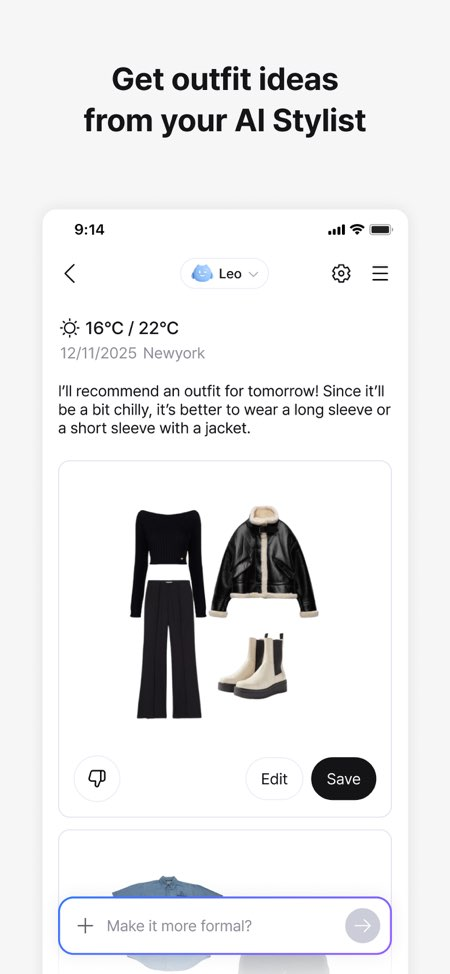
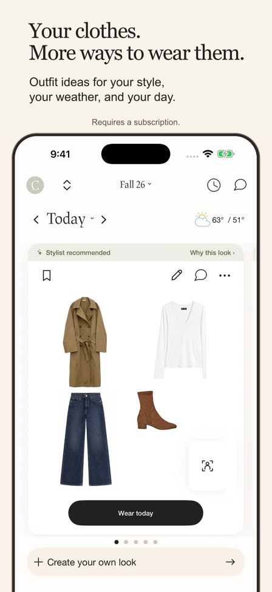
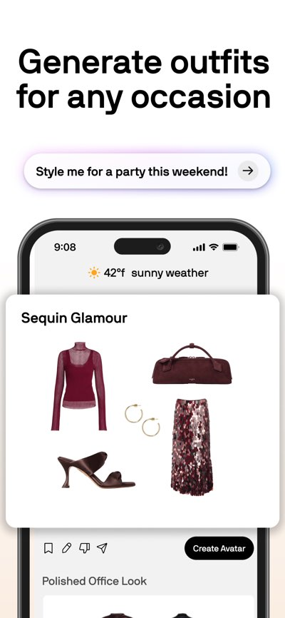
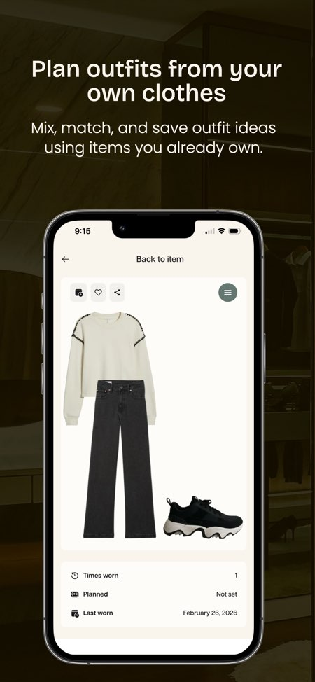
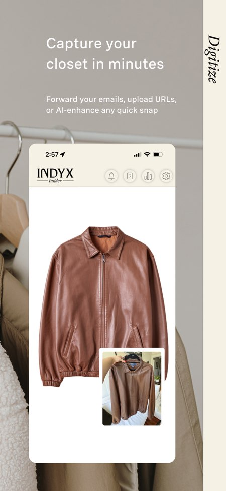
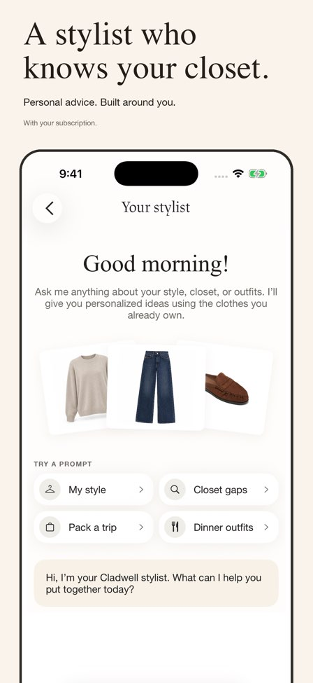
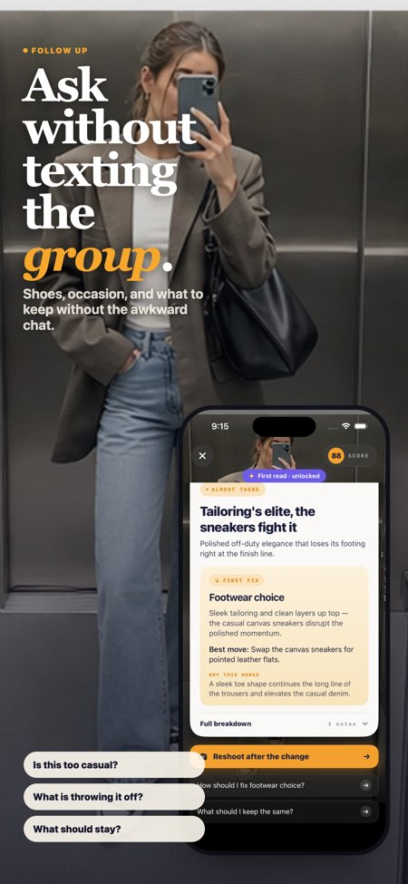
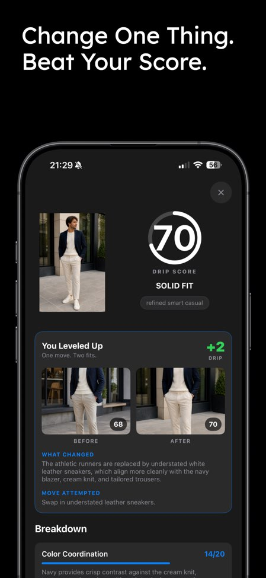

# How good stylist apps show answers visually in chat

Date: 2026-11-16. Research only; no app was installed, no account made, nothing paid. Feeds the spec interview for Kit's visual answers (the tester's three complaints: mostly text, color advice that looked bad, no offer to add a piece he said he owns). Cloud copy: not published yet.

## What I did, and what I could not see

- **Read:** the App Store pages (text, reviews, screenshot frames) of Alta, Whering, Indyx, Acloset, Stylebook, Cladwell, OpenWardrobe, DRPD (Rate My Outfit AI) and Looksee; Cladwell's and Alta's own sites; OpenWardrobe's help blog; OpenAI's help and launch pages for ChatGPT shopping; Apple's Human Interface Guidelines (Generative AI, Alerts, Color), read through the developer site's own data feed.
- **Not seen:** a live chat in any of them. App Store frames are marketing, so they show the best case, and I cannot say how often the app produces that card. I did not sign in anywhere. Reddit refused to open in the in-app browser, so Reddit evidence is limited to the public search snippets (titles and first lines), not full threads.
- **Screenshots** in `2026-11-16-chat-visuals-research/` are the apps' own App Store marketing frames, kept as internal reference only. They belong to the apps' owners: do not publish them or make this repo public with them in it (CLAUDE.md already says to ask first about going public).
- **Confidence tags** below: *seen* (I looked at the frame or page text), *claimed* (the app says so, I did not see it), *inferred* (my reading).

## The short version

1. The apps that answer well in chat all do the same thing: **a short sentence of words, then one picture of the answer** (a flat-lay of the actual pieces), with a small row of actions under it. The words explain; the picture is the answer.
2. The best rule I found for a thin closet comes from Cladwell: every piece Kit names is marked as owned or not owned, in the same breath. That is the honest version of "a drawn example when the closet is thin", and it matches Kitted's drawn-in-code pieces.
3. Nobody I could verify shows a plain "add this to your closet" card in chat. The nearest are Cladwell (its stylist can save a look or add it to a list in one tap, claimed) and ChatGPT (a bookmark on a product, seen in its help page). So the card is less proven than the outfit board: design it carefully and test it with the founder's phone, not just on paper.
4. Color advice that "looks bad" is mostly a words-only problem. Where apps show color, it is a short row of named chips tied to clothes, and it comes from a fixed palette, not from the model's guess. The ones that read skin tone or body shape are out for Kitted.

## The patterns

### P1. Outfit board in the reply: a flat-lay of the user's own pieces

**What it looks like.** One white card in the chat. Four to five cut-out pieces laid out on a plain background (top, bottom, shoes, one extra), no person. One or two plain sentences above it ("since it's chilly, a long sleeve with a jacket"). Small buttons under it: a dislike, Edit, Save.

**Who does it well.**
- **Acloset:** the clearest chat example. Its AI stylist replies with a sentence and then an outfit card from the user's own closet, with thumbs-down, Edit and Save, and a message box that suggests a follow-up ("make it more formal?"). *Seen.* [Acloset App Store](https://apps.apple.com/ai/app/acloset-ai-fashion-assistant/id1542311809)
- **Cladwell:** a card per day, labeled as the stylist's recommendation, with a "Why this look" link, Wear today and Create your own look. *Seen.* [Cladwell App Store](https://apps.apple.com/us/app/cladwell-ai-stylist-outfits/id1140550878)
- **Alta:** named boards ("Chic Brunch", "Sequin Glamour") that are a flat-lay on a white card, and a pill to type a request ("style me for a party this weekend"). *Seen.* [Alta App Store](https://apps.apple.com/us/app/alta-daily-digital-ai-closet/id6481705400), [altadaily.com](https://www.altadaily.com)
- **OpenWardrobe:** its "Plan an Outfit" uses only pieces already in the wardrobe, never catalog items; it is a form, not a free chat. *Claimed (blog) and seen (frame).* [OpenWardrobe blog](https://www.openwardrobe.co/blog/plan-an-outfit-lolaai-clothes-you-own)

**Fits Kitted?** Yes, and it is the one that fixes "mostly text". Kitted already draws pieces in code (`specs/onboarding-screens.md` says the drawn outfit is built on `features/closet/flats.ts`, never a person), so no photos of people are needed. Watch-outs: none of these apps need emoji, and the brand names say "AI stylist" in their own marketing, which Kit must not copy. A reviewer of Cladwell complained that suggested pieces show no names, so with several black jeans you cannot tell which one: Kit's card should say the piece names too (*seen in a 2022 review*).

### P2. Owned versus not owned, and a drawn example when the closet is thin

**What it looks like.** The outfit card holds the pieces the user owns as their own pictures, and the missing piece appears as a plainly different tile (a drawn example, a dashed edge or a "not in your closet" label), with the reason it finishes the look.

**Who does it well.**
- **Cladwell** states it as a rule on its stylist page: every item it names is flagged as owned or not owned. Its example answer names two owned pieces and says plainly that no suitable shoe is owned yet, then names one that would finish it and says you would wear it well beyond that day. Elsewhere on the page it says a gap is named only when the closet is short of it, and that the number of outfits it unlocks is the whole argument. It says it will not pretend you own something, will not push you to buy, and has no affiliate links. *Claimed on its site; its App Store text also says the capsule gives "the few pieces worth finding".* [cladwell.com/stylist](https://cladwell.com/stylist)
- **Alta** names closet gaps and offers shopping picks and a wishlist, and promises to show how to wear a new piece by generating outfits with it. *Claimed.* [Alta App Store](https://apps.apple.com/us/app/alta-daily-digital-ai-closet/id6481705400)
- **OpenWardrobe** goes the other way: it refuses anything not in the wardrobe, so a thin closet gives thin answers. *Claimed.*

**Fits Kitted?** Yes, with one care. A drawn example must read as "an example" at a glance (different tile, one plain label) so it never looks like the user's own piece. Kit is also not a shop: Cladwell's no-affiliate stance is a good model, and nothing in `specs.md` has Kitted selling clothes.

### P3. "Add this to your closet?" confirm card

**What it looks like.** A small card under Kit's sentence: a picture of the piece as Kit understood it (name, color, type), then two buttons, Add and No thanks. After Add, the card collapses into a single line ("Added to Closet") with Undo.

**Who does something like it.**
- **Cladwell:** its stylist can save a look, add it to a list, or show it on you "in one tap". *Claimed.* No evidence of a card that asks first.
- **Indyx and Alta:** adding is a separate flow where the app recognizes the item, cleans the photo and lets you edit every detail; Indyx's frame shows the original snapshot as a small inset on the cleaned item. That is a good model for what the card should show before the user says yes. *Seen (Indyx frame); Alta and Cladwell claimed.* [Indyx App Store](https://apps.apple.com/us/app/indyx-wardrobe-outfit-app/id1599179405)
- **ChatGPT:** every product has a bookmark that saves it to a Favorites library; one tap, and tapping again removes it. Seen in OpenAI's help page. [OpenAI help](https://help.openai.com/en/articles/11128490-shopping-with-chatgpt-search)
- **Apple's HIG** (the rule book for iOS design) says: keep people in control, let them dismiss content they do not want and undo actions they did not agree to; and do not use an alert merely to give information, nor for common actions that can be undone. A card in the chat with an Undo meets this; a pop-up alert does not. [HIG: Generative AI](https://developer.apple.com/design/human-interface-guidelines/generative-ai), [HIG: Alerts](https://developer.apple.com/design/human-interface-guidelines/alerts)

(Also in the folder, not used above: `alta-daily-outfit-home.jpg`, `acloset-ai-stylist-entry.jpg`.)

**Fits Kitted?** Yes, and it is Kitted's own idea with little precedent in the field, so it is a differentiator. It fits two existing rules: the closet belongs to the closet service (CLAUDE.md), and Kitted already has an "Added {n} to Closet" row after a scored check. Watch-outs: the card should show Kit's reading of the piece (never a guess about the person), No thanks must cost nothing (no nag the next time the same piece is mentioned), and a piece Kit is unsure about should ask a short question first.

### P4. Color swatch row

**What it looks like.** A single row of three to five round or rounded-square chips, each with the color's name under it ("navy", "olive", "stone"), sitting under Kit's sentence. For pairing advice: the piece the user owns on the left, then "goes with" and the chips. For an outfit: the chips are the outfit's colors in the order they appear.

**Who does it, and how well.**
- **Cladwell** has a Colors tab with a seasonal palette, and its season capsule lists the role each color plays in the outfits. The palette comes from a photo reading of the user's coloring, so those chips are about the person. *Claimed.*
- **Acloset** offers "find my color" and "fit diagnosis" from the user's looks. *Claimed.*
- **Whering** shows a color-palette insight of the user's own closet ("your go-to hues and gaps"). *Claimed.* [Whering App Store](https://apps.apple.com/us/app/whering-your-digital-closet/id1519461680)
- Skin-tone color tools (Stylist AI, color-analysis sites, Atelier's body-shape quiz) are a crowd of their own. *Seen in search results.*
- On Reddit's r/malefashionadvice (search snippets only, and old: roughly 2023 for the first, 2014 for the second): a thread says ChatGPT did a poor job on dress ideas and struggles with color and outfit composition; another is a man thanking a color-matching app for stopping him from wearing a purple tie with a light-blue shirt, noting it helps if you are colorblind. A "classic menswear palette" thread offers 32 coordinated colors. This is the same hurt the tester reported, and it points at a fixed palette with names rather than free-form model color talk. *Public snippets, not read in full.*

**Fits Kitted?** Yes, in a narrow form. The AI sees, the code judges: the chips should come from the colors `@kitted/core` already extracts, and the "goes with" row from a fixed table the code owns, so the same pieces always give the same chips. **Never** tie a palette to skin, face or body (the Hard lines), so the Cladwell, Stylist AI and Atelier style of "your colors" is out. Two traps from the HIG: color must not be the only carrier of meaning, so always print the color name next to the chip, and swatches must be checked on both light and dark themes. [HIG: Color](https://developer.apple.com/design/human-interface-guidelines/color)

### P5. Follow-up chips under the answer

**What it looks like.** Two to four short tappable lines under Kit's reply: "Is this too casual?", "What should stay?", "Make it more formal". One tap sends it as the next message.

**Who does it well.**
- **Looksee** (a close rival: outfit verdict from a mirror photo, 18+, "no body talk", says so in its store text): frame five shows chips like "Is this too casual?" next to its First Fix card. *Seen.* [Looksee App Store](https://apps.apple.com/in/app/looksee-ai-personal-stylist/id6757265239)
- **Cladwell:** four prompt tiles on the empty stylist screen (my style, closet gaps, pack a trip, dinner outfits). *Seen.*
- **Acloset:** a message box that suggests the next ask. *Seen.*
- **Apple's HIG:** for open-ended features, offer curated suggestions so people can get started, and set clear expectations about what the feature can and cannot do. *Source: HIG: Generative AI.*

**Fits Kitted?** Yes. Cheap, and it keeps the answer short because the next question is one tap away. Watch-outs: Looksee's store frames use all-caps labels and a "roast" voice; copy neither.

### P6. One move, with before and after

**What it looks like.** A verdict, then one specific change, then (after the user fixes it) a before and after pair with the change in points.

**Who does it.** DRPD ("Level-Up move", rescan, before and after with +2) and Looksee ("First Fix"). *Seen.* [DRPD App Store](https://apps.apple.com/us/app/rate-my-outfit-ai-drpd/id6759729079)

**Fits Kitted?** The idea is already Kitted's (score, a word, the fix that raises it). The copy is not: DRPD uses an emoji next to its verdict, all-caps labels and a streak. Not a new chat pattern; it belongs to the check card, so it is only a reference here.

### Seen, and rejected for Kitted

| Pattern | Who | Why it does not fit |
| --- | --- | --- |
| Avatar or "see it on me" try-on | Alta, Cladwell, ChatGPT ("Try on" from a selfie, Oct 2026, [TechCrunch](https://techcrunch.com/2026/10/01/chatgpt-can-now-virtually-try-on-clothes-for-you/)) | Needs an unblurred photo of the user; Kitted sends only the blurred copy and never judges bodies. Possible later only as a drawn figure (`specs.md` lists it under Later). |
| Skin-tone color season, body-shape quiz | Stylist AI, Atelier, OpenWardrobe Style Blueprint | Judges skin and body: a Hard line. |
| Roast, hype-man and other voices | Looksee | Breaks Kit's one calm voice, and the roast leans on appearance. |
| Product carousel with prices | ChatGPT shopping ([OpenAI](https://openai.com/index/powering-product-discovery-in-chatgpt/)), Alta | Makes Kit a shop. A single not-owned piece is fine (P2); a store grid is not in the spec. |
| Moodboards, social closets | Whering, Indyx | A different product (community), and a privacy cost for a closet that is private. |
| Wear stats and cost per wear | Whering, Indyx, Acloset, Alta | Tracking, not chat. |

## Ranked: the five patterns for Kit's answers

1. **Outfit board from the user's own pieces (P1).** Best evidence, directly fixes "mostly text", and Kitted already draws pieces in code. Trade-offs: needs a closet with enough pieces; the card must carry piece names so two similar pieces are not confused; Kit must say plainly when a card is a drawn example. Highest value per build effort.
2. **Owned or not-owned marker plus a drawn example when the closet is thin (P2).** The honest answer to a small closet, and it stops Kit from inventing pieces. Trade-offs: a drawn example is only as good as the shapes Kitted can draw; it must never read as the user's own piece. Build it with P1: they are one card.
3. **Add-to-closet card, Add / No thanks, with Undo (P3).** Least precedent in the field, so it is a real differentiator, and it answers the tester directly. Trade-offs: a wrong reading of a piece makes the user fix it by hand, so keep the card to name, type and color and ask a short question if unsure; asking too often becomes a nag, so once per piece per chat.
4. **Follow-up chips (P5).** Cheap, proven, makes shorter answers possible. Trade-offs: only useful if the chips are good and few (two to three); bad chips are noise, and they are another thing to translate and keep free of caps and emoji.
5. **Named color chips from a fixed table (P4).** Answers "color advice that looked bad", but ranks fifth because it needs the most of Kitted's own work and the evidence from other apps is mostly marketing, not seen working in chat. Trade-offs: chips must come from the core's palette so Kit cannot contradict the score; always print the color name; never tie colors to skin or face, which removes the most popular version of the feature.

Not ranked: the before and after pair (P6) is already the check card's job.

## Questions this leaves for the founder interview

- Is a drawn example (never a person) acceptable as the answer when the closet is thin, labeled plainly as an example?
- Should the add card appear when Kit only hears a piece mentioned in chat ("I have a navy blazer"), or only after he confirms with a photo?
- How many cards in one reply: one outfit, or a few (Alta and Cladwell show several, Acloset one)? I would start with one.

## Engineering note (for the interview)

What these apps do is called a typed or "structured" message. The model does not draw; it picks a message type from a short fixed list (a sentence, an outfit card, a color row, an add card) and fills in the fields, and the app renders each type with its own component. That is the same split as Kitted's rule "the AI sees, the code judges, the AI explains", and the same idea behind tool calling in the Claude API. In an interview you can describe it as "the model returns JSON that the client validates and renders, so a bad answer cannot break the layout".

## Sources

- Alta: [App Store](https://apps.apple.com/us/app/alta-daily-digital-ai-closet/id6481705400), [altadaily.com](https://www.altadaily.com)
- Cladwell: [App Store](https://apps.apple.com/us/app/cladwell-ai-stylist-outfits/id1140550878), [stylist page](https://cladwell.com/stylist), [app page](https://cladwell.com/app)
- Acloset: [App Store](https://apps.apple.com/ai/app/acloset-ai-fashion-assistant/id1542311809)
- Whering: [App Store](https://apps.apple.com/us/app/whering-your-digital-closet/id1519461680)
- Indyx: [App Store](https://apps.apple.com/us/app/indyx-wardrobe-outfit-app/id1599179405)
- OpenWardrobe: [App Store](https://apps.apple.com/us/app/openwardrobe/id1549029468), [Plan an Outfit with LolaAI](https://www.openwardrobe.co/blog/plan-an-outfit-lolaai-clothes-you-own)
- Stylebook: [App Store](https://apps.apple.com/us/app/stylebook/id335709058) (manual closet and outfit collage; no chat found)
- DRPD: [App Store](https://apps.apple.com/us/app/rate-my-outfit-ai-drpd/id6759729079)
- Looksee: [App Store](https://apps.apple.com/in/app/looksee-ai-personal-stylist/id6757265239)
- ChatGPT: [Powering product discovery](https://openai.com/index/powering-product-discovery-in-chatgpt/) (Mar 24, 2026), [Shopping help page](https://help.openai.com/en/articles/11128490-shopping-with-chatgpt-search), [TechCrunch on try-on](https://techcrunch.com/2026/10/01/chatgpt-can-now-virtually-try-on-clothes-for-you/) (search snippet only)
- Apple HIG: [Generative AI](https://developer.apple.com/design/human-interface-guidelines/generative-ai), [Alerts](https://developer.apple.com/design/human-interface-guidelines/alerts), [Color](https://developer.apple.com/design/human-interface-guidelines/color)
- Reddit (search snippets only, threads not opened): [ChatGPT for dress ideas](https://www.reddit.com/r/malefashionadvice/comments/10ss7or/using_chatgpt_for_dress_ideas/), [color app for the colorblind](https://www.reddit.com/r/malefashionadvice/comments/1ysg3p/this_app_is_saving_me_from_clothing_humiliation/), [a menswear palette](https://www.reddit.com/r/malefashionadvice/comments/1n4eox/a_classic_menswear_color_palette_32_coordinated/), [Acloset AI suggestions](https://www.reddit.com/r/fashionwomens35/comments/13zfe36/fun_with_apps_acloset_ai_suggestions_do_they_work/)
