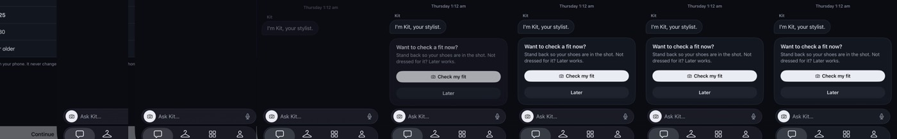
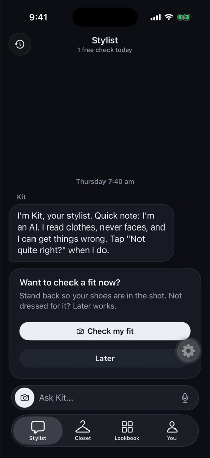
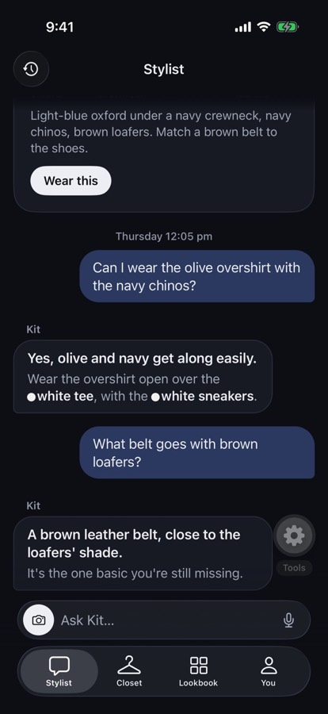

# Making Kit's replies feel alive: research and proposals

Nov 18, 2026. Research and design only: no app code, `specs.md` or approved spec was changed. Animated mockups of the top proposals: [`2026-11-18-chat-feel-mockups.html`](2026-11-18-chat-feel-mockups.html) (light and dark, with slow motion and a Reduce Motion switch). Cloud copy of the mockups: [open](https://claude.ai/artifact/8yeSzn6o2zVNHaBpD9XX6S).

**In short.** Kit's chat isn't flat everywhere. Kit's messages already fade in and rise (your pick, Nov 12), the typing dots pulse, and the score reveal is a real moment. The flatness has four exact causes, all at the end of a reply:
1. The card, the most important part of an answer, appears in one frame with no motion.
2. Every sentence after the first pops in whole.
3. Nothing marks that the answer is complete.
4. The lines Kit posts on its own (the hello after setup, "Your first 3 moves") drop in like notices instead of being said.

Each fix is small, and none needs a new package. My pick is in the last section.

---

## 1. What Kit does today

Read from the code on `main` (Nov 18). Screenshots are from earlier Simulator runs on disk. Nothing was booted for this report, because the Mac was at about 300 MB free.

| Moment | What he sees today | Where |
|---|---|---|
| A new message from Kit | Fades in while rising 8 pt, 250 ms. Several at once land 100 ms apart. It plays only for messages he hasn't seen, and only once. With Reduce Motion: the same fade, no rise. | `stylist/arrival.ts`, `arrivalMotion.ts` (log #458) |
| Waiting for an answer | Three 6 pt grey dots pulse in turn (420 ms, 140 ms apart), in Kit's spot. After 6 s, "Taking longer…" appears under them and is read aloud. With Reduce Motion: a still "…". | `ask/LiveAnswerRow.tsx` |
| The words | The answer streams one checked sentence at a time (the gate). The first words fade in over 180 ms. Every later sentence appears with no motion. With Reduce Motion even the first fade is gone (`ReduceMotion.System` skips fades). | `LiveAnswerRow.tsx`, `ask/pipeline.ts` |
| The card and follow-up taps | They arrive only when the stored answer replaces the live one at the end. That stored row is told not to move (so the words don't play twice), so **the card and taps appear in one frame with no entrance**. The thread then scrolls to show them. | `StylistScreen.tsx` (`liveRowId` skip), `MessageView.tsx` (`AskAttachment` in the footer) |
| Scrolling | While he's at the bottom, the thread follows each new line with an animated scroll. If he's scrolled up, a "Latest" pill offers the way down. With VoiceOver on, only his own sends move the thread. With Reduce Motion it jumps. | `StylistScreen.tsx`, `LatestPill.tsx` |
| Haptics | **None for any of Kit's messages.** In the chat: one Rigid tap when a score of 6.0+ locks in, one Success tap on a re-check win (the only one in the app), and selection ticks on taps. There's no sound anywhere, and no haptics switch in the app. | `stylist/cards/useReveal.ts`, `fitcheck/reveal.ts` |
| VoiceOver | While Kit works, the row reads "Kit is writing". The finished answer is read once, queued behind any current speech. | `ask/session.ts`, `ask/live.ts` |
| Right after setup | Setup slides away, and the thread waits 500 ms. Kit's first line ("I'm Kit, your stylist. Quick note: I'm an AI…") and the "Want to check a fit now?" card then rise in 100 ms apart. Then nothing moves. | `arrival.ts` (`settleMs`), `onboarding/firstCheckOffer.ts` |
| After the first fit check | The score reveal plays (a tape slides to the number, one Rigid tap, the word rises, then the fixes). 4 s later "Your first 3 moves" lands like any Kit message, and the paywall opens 2.5 s after that. | `finish/sequence.ts` |

*After setup, frame by frame: the thread slides in, then the line and the card rise together and stop.*

*Left: what he's left looking at after setup. Right: two answers in the thread (an older demo screen; the new answer cards come with the card views task).*

**Not seen on a device:** the hand-off from the live answer to the stored row with its card. It's read from the code, and `tasks/kit-arrives/TASK.md` lists it as not shown on the Simulator. Seeing it on your phone would take 30 seconds: ask Kit an outfit question and watch the card appear.

---

## 2. What the research says

Labels: **read** means the page itself was read. **Abstract** means only the abstract or a summary was read. **Snippet** means search results or secondary sources only.

### How other chat apps do it
- **Three dots are the shared signal for "a reply is coming."** iMessage shows the bubble while the other person types and keeps it about 60–90 s after they stop ([BGR](https://bgr.com/2192532/why-imessage-shows-three-blinking-dots-explained/), read). WhatsApp moved its typing dots from the header into the chat itself in late 2024 ([WABetaInfo](https://wabetainfo.com/whatsapp-news-of-the-week-redesigned-typing-and-recording-indicator-for-ios-and-android/), snippet). Kit already does this.
- **Answers stream, and the rich parts are filled in afterwards.** Amazon's Rufus streams the answer as it's written, then fills in live items, prices and links ([IEEE Spectrum, by Rufus's lead](https://spectrum.ieee.org/amazon-rufus), read). That's the same shape as Kit's words-then-card. No source describes a bounce or showy entrance for product cards.
- **Haptics during streaming get complaints.** ChatGPT's iPhone app buzzes while it writes. Enough people found it annoying that guides explain how to turn it off ([Wccftech](https://wccftech.com/how-to/disable-annoying-haptic-feedback-vibrations-in-chatgpt-for-iphone-tutorial/), read; [Reddit thread](https://reddit.rtrace.io/r/apple/comments/13l4hcy/usonly_official_chatgpt_app_for_ios/), user reports). Claude's app added a haptics switch ([TestingCatalog](https://testingcatalog.com/claude-ai-mobile-update-brings-smoother-navigation-haptic-feedback-and-more), read). The lesson: one tap at most, never a running buzz.
- **iMessage's showy effects (Slam, Loud) are chosen by the sender, never the default** ([Apple Support](https://support.apple.com/en-asia/guide/ipad/animate-messages-ipad1464ec49/16.0/ipados), snippet). A plain arrival is the norm.
- **Not verified:** how Gemini, Character.AI, Replika, Pi, Zalando, Klarna, Alta, Whering and Stitch Fix animate a reply or a card. No primary source describes it, and I won't guess. Stitch Fix's nearest equivalent is the stylist's signed note in each box ([Stitch Fix support](https://support.stitchfix.com/support/solutions/articles/153000173925), snippet). That's a human touch, not a motion.

### Apple's rules
- **Motion:** use it with purpose; too much distracts and can cause discomfort. Keep feedback motion brief. Avoid adding motion to frequent interactions. Never make people wait on an animation ([HIG: Motion](https://developer.apple.com/design/human-interface-guidelines/motion), read).
- **Reduce Motion:** cut automatic and repeating animation, replace slides with **fades**, and tighten springs so they don't bounce ([HIG: Accessibility](https://developer.apple.com/design/human-interface-guidelines/accessibility), read).
- **Haptics:** use each pattern for its meaning (Soft is for a soft object settling, Rigid for a hard one, Success for completion). Link each tap clearly to its cause, match it to the animation, and don't overuse them: "the best haptic is one people may not notice but miss when off." **Make haptics optional** with an in-app switch ([HIG: Playing haptics](https://developer.apple.com/design/human-interface-guidelines/playing-haptics), read). Apple's audio-haptic talk adds "don't add feedback just because you can" ([WWDC19 810](https://developer.apple.com/videos/play/wwdc2019/810), snippet).
- **Springs:** use bounce 0 for most UI. About 0.3 already looks bouncy, and above 0.4 looks exaggerated ([WWDC23 "Animate with springs"](https://developer.apple.com/videos/play/wwdc2023/10158/), via [WWDC Notes](https://wwdcnotes.com/documentation/wwdc23-10158-animate-with-springs/), read).
- **VoiceOver:** tell VoiceOver when visible content changes ([HIG: VoiceOver](https://developer.apple.com/design/human-interface-guidelines/voiceover), read). React Native's `announceForAccessibilityWithOptions` can queue an announcement or give it a low priority on iOS ([React Native docs](https://reactnative.dev/docs/accessibilityinfo), read). Kit already queues its finished answers.
- **Small fades are safe for motion-sensitive people.** The risk grows with how far things travel across the screen: big slides, zooms, parallax. Opacity changes are unlikely to cause symptoms ([A List Apart](https://alistapart.com/article/designing-safer-web-animation-for-motion-sensitivity/), read; [WCAG 2.3.3](https://www.w3.org/WAI/WCAG22/Understanding/animation-from-interactions.html), read).
- **Two library facts that shape the build:**
  - Reanimated's default `ReduceMotion.System` removes fades too, so every fade meant to survive Reduce Motion needs `.reduceMotion(ReduceMotion.Never)`, as `arrivalMotion.ts` already does ([Reanimated accessibility](https://docs.swmansion.com/react-native-reanimated/docs/guides/accessibility/), read).
  - expo-haptics does nothing when the phone's system haptics are off, in Low Power Mode, or while dictation or the camera runs ([Expo Haptics](https://docs.expo.dev/versions/latest/sdk/haptics/), read). The phone's own switch is respected for free.

### Timing and attention
- **Speed limits:** 0.1 s feels instant. 1 s keeps the flow of thought, so past 1 s show that work is happening. 10 s is the limit of attention. For waits of unknown length, naming each step beats a spinner ([NN/g, response times](https://www.nngroup.com/articles/response-times-3-important-limits/), read).
- **Animation length:** about 100 ms for small feedback, 200–300 ms for bigger changes, 400 ms only for large moves. 500 ms already feels like "a drag." Animations are far more often too long than too short, and things seen often should be shorter and subtler ([NN/g, animation duration](https://www.nngroup.com/articles/animation-duration/), read). Kit's 250 ms arrival sits right in that range.
- **The start of a motion catches the eye, not motion that keeps going** ([Abrams & Christ 2003, *Psychological Science*](https://pubmed.ncbi.nlm.nih.gov/12930472/), abstract). This is the strongest reason for one short entrance on the card instead of a pulse or loop. Something that keeps moving is noise.
- **A small, natural delay can make a chatbot feel more present, but mostly for new users.** Dynamic delays beat instant replies on humanness and satisfaction ([Gnewuch et al. 2018, ECIS](https://aisel.aisnet.org/ecis2018_rp/113/), abstract). Typing dots raised social presence only for people new to chatbots ([Gnewuch et al. 2018, SIGHCI](https://aisel.aisnet.org/sighci2018/14/), abstract). In a lab study of 202 people, a delay helped novices and hurt experienced users ([Gnewuch et al. 2022, *BISE*](https://aisel.aisnet.org/bise/vol64/iss6/5), abstract). **For Kitted:** a short typing beat fits his first minutes (right after setup, his first score), not every answer.
- **An answer that is too fast can read as less thought-through.** In a CHI 2026 study, a first word at 2 s was rated less thoughtful and less useful than one at 9 or 20 s ([Tan et al. 2026](https://arxiv.org/abs/2604.06183), abstract). Don't slow Kit down on purpose. It does mean his ~2 s answers gain from looking deliberate (sentences arriving calmly, the card on its own beat) rather than dumped.
- **Showing the work raises the value people feel** (the "labor illusion"). People valued a service more when they could see it working, even over an instant identical result ([Buell & Norton 2011, *Management Science*](https://ideas.repec.org/a/inm/ormnsc/v57y2011i9p1564-1579.html), abstract). Waits that are unexplained or empty feel longer ([Maister 1985](https://davidmaister.com/?p=328), snippet; an essay, not measurements). This only works if what's shown is true.
- **Haptic overuse:** no primary study on wearing out haptics was found. One study suggests spacing vibrations at least 1 s apart ([Yale-NUS via TechXplore](https://techxplore.com/news/2020-06-smart-devices-space-vibrations-maximize.amp), snippet).
- **Where the evidence is thin:** no real study compares word-by-word streaming with sentence-by-sentence or whole-message reveal. Claims like "streaming feels 40% faster" come from blogs without sources, so this report doesn't use them. The same goes for skeleton screens versus spinners: one small test, mixed results ([Viget](https://viget.com/articles/a-bone-to-pick-with-skeleton-screens), snippet).

---

## 3. Proposals, ranked by impact and cost

Every proposal keeps the house style: no emoji, no all-caps, no rewards, no bounce, and no copper (copper marks score movement only, `handoff/03` principle 1). Nothing here adds a package: Reanimated and expo-haptics are installed. Sizes follow `CLAUDE.md`: tiny (a small change the session does alone) or normal (built and tested, then one reviewer).

| # | Proposal | Impact | Build | Annoyance risk | Where it goes |
|---|---|---|---|---|---|
| 1 | The card lands as its own beat, follow-up taps last | High | Normal (small, inside T104) | Low | **T104** |
| 2 | One soft tap when an answer is complete | Medium–high | Tiny | Medium | Own tiny task |
| 3 | Each sentence fades in as it arrives | Medium | Tiny | Low | With #2 |
| 4 | Kit types before it speaks on its own (after setup, before "Your first 3 moves") | High for the first session | Normal | Low–medium | Own task, before the beta restart |
| 5 | A true one-line status while Kit works | Low–medium | Normal | Medium | After T105, if waits run long |
| 6 | "New from Kit" when he's scrolled up or on another tab | Medium | Normal | Medium | Own task, after beta feedback |
| 7 | Keep the start of a long answer in view | Low today | Normal | Low | Later |

### 1. The card lands as its own beat (mockup 1)
- **What he sees:** the words stream in as now. About 120 ms after the last sentence, the card fades in while rising 12 pt over 280 ms. The thread glides up with it. The follow-up taps fade in last, 50 ms apart. His eye goes from the move, to the picture, to what's next.
- **Why:**
  - The card is the answer as a picture (spec KC1), and today it's the only part with no entrance.
  - The start of a motion is what catches the eye ([Abrams & Christ](https://pubmed.ncbi.nlm.nih.gov/12930472/)).
  - 200–300 ms is the right length for a change this size ([NN/g](https://www.nngroup.com/articles/animation-duration/)).
  - Rufus fills in its rich parts after the text in the same way ([IEEE Spectrum](https://spectrum.ieee.org/amazon-rufus)).
- **Annoyance risk:** low. It plays once per answer, only for a new one, never in Past chats or on scroll-back (the `arrival.ts` rules). The rise is 4 pt more than a message's, so the card reads as the main thing without bouncing.
- **Reduce Motion:** the same order as plain fades (card 200 ms, then the taps), and the thread jumps instead of gliding.
- **VoiceOver:** no change. The finished answer is already read once. The card's own label is T104's work.
- **Size and files:** normal, but small inside T104, which builds these cards and the follow-up row anyway.
  - `stylist/StylistScreen.tsx`: the just-finished row keeps its words still but lets its attachment enter.
  - `stylist/MessageView.tsx`: wrap `AskAttachment` and the follow-up row in an `Animated.View` with `entering`.
  - `stylist/arrivalMotion.ts`: a card variant and a tap stagger.

### 2. One soft tap when an answer is complete (marked in mockups 1 and 2)
- **What he feels:** one light `Soft` impact as the answer completes, timed with the card settling (or the last sentence when there's no card).
- **Rules:**
  - Once per answer, and only for an answer to something he asked.
  - Only while the app is in front and the thread is on screen at the bottom.
  - Never per sentence. Never for the morning card or other posts he didn't ask for.
- **Why:**
  - Apple's Soft pattern is for a soft object settling, and a tap should match the motion it goes with ([HIG](https://developer.apple.com/design/human-interface-guidelines/playing-haptics)).
  - It gives an answer an end, and it reaches him even when his eyes have drifted to the keyboard.
  - ChatGPT's running buzz drew complaints ([Wccftech](https://wccftech.com/how-to/disable-annoying-haptic-feedback-vibrations-in-chatgpt-for-iphone-tutorial/)), so this is the opposite: one tick.
- **Annoyance risk:** medium. Over 20 questions that's 20 taps. Two things soften it:
  - It's free to drop. The phone's system haptics switch already turns it off ([Expo](https://docs.expo.dev/versions/latest/sdk/haptics/)).
  - Apple asks apps for their own switch ([HIG](https://developer.apple.com/design/human-interface-guidelines/playing-haptics)). **Proposal for you:** a "Haptics" switch in You's settings before launch (words users read, so your call).
- **Reduce Motion:** the tap stays (it isn't motion; the score reveal keeps its tap under Reduce Motion too).
- **VoiceOver:** the tap fires alongside the announcement. Haptics also reach VoiceOver users ([HIG: Feedback](https://developer.apple.com/design/human-interface-guidelines/feedback)).
- **Size and files:** tiny. `ask/session.ts` (next to `onAnswered`, where the announcement already happens), or the card's entrance from #1.

### 3. Each sentence fades in as it arrives (mockup 2)
- **What he sees:** each new sentence fades in over 160 ms where it lands, instead of popping. Nothing moves sideways or up, so the text never jumps under his eyes.
- **Why:** Kit's words arrive in sentence chunks (they're checked one sentence at a time), so whole sentences appearing at once is jumpier than ChatGPT's word-by-word flow. A short fade makes each chunk read as arriving, not appearing ([NN/g](https://www.nngroup.com/articles/animation-duration/): small changes about 100–200 ms). There's no hard study on how streamed text should reveal, so this rests on design principle, not measurement.
- **Annoyance risk:** low. Answers are 1–3 sentences (the 40/60-word cap).
- **Reduce Motion:** the fades stay. A fade is Apple's suggested replacement, and opacity is the safe kind of change ([A List Apart](https://alistapart.com/article/designing-safer-web-animation-for-motion-sensitivity/)). It needs `ReduceMotion.Never`, because today's first-words fade silently disappears under Reduce Motion.
- **VoiceOver:** no change. Streamed half-sentences are already not read.
- **Size and files:** tiny. `ask/LiveAnswerRow.tsx` and `ask/AnswerBody.tsx` (a stable key per sentence, so the stored row taking over doesn't fade them twice).

### 4. Kit types before it speaks on its own (mockup 3)
- **What he sees:** right after setup, Kit's typing dots show for about 0.9 s. They become Kit's first line, and the "Want to check a fit now?" card follows on its own beat with one soft tap. The same beat could come before "Your first 3 moves" after his first score, so that card reads as Kit talking to him, not a notice dropping in.
- **Why:**
  - These are his first minutes, and a short typing beat raises presence most for new users ([Gnewuch et al. 2018](https://aisel.aisnet.org/sighci2018/14/), [2022](https://aisel.aisnet.org/bise/vol64/iss6/5)).
  - Typing dots are the shared "someone is answering" signal ([BGR](https://bgr.com/2192532/why-imessage-shows-three-blinking-dots-explained/)).
  - It's honest: Kit's first line already says it's an AI, so the dots are a pause, not a pretend person.
- **Annoyance risk:** low to medium. It adds about 1 s to two moments that happen once per phone. Keep it off the morning card and off answers, where it would only delay what he came for, and where experienced users find delays worse ([Gnewuch 2022](https://aisel.aisnet.org/bise/vol64/iss6/5)).
- **Reduce Motion:** a still "…" for the same 0.9 s, then fades.
- **VoiceOver:** the dots row reads "Kit is writing" (the existing label). The line is announced when it lands (`onPosted` already does this).
- **Size and files:** normal, as its own task.
  - `stylist/arrival.ts`: decide which posted rows get a typing beat.
  - `stylist/StylistScreen.tsx`: hold the row behind the dots the first time it's drawn.
  - `onboarding/firstCheckOffer.ts` and `finish/session.ts`: mark those two posts.
  - It doesn't touch T104–T108's files except `StylistScreen.tsx`.

### 5. A true one-line status while Kit works
- **What he sees:** if no words have come after about 1.5 s, one grey line joins the dots saying what Kit is doing, taken from what the code is actually doing: for example "Looking through your closet" for an outfit question, or "Reading your last check" for a "why" question. "Taking longer…" stays at 6 s.
- **Why:**
  - Past 1 s, show that work is happening, and naming the step beats a spinner ([NN/g](https://www.nngroup.com/articles/response-times-3-important-limits/)).
  - Seeing the work raises its felt value ([Buell & Norton](https://ideas.repec.org/a/inm/ormnsc/v57y2011i9p1564-1579.html)).
  - Explained waits feel shorter ([Maister](https://davidmaister.com/?p=328)).
- **Annoyance risk:** medium, for two reasons. If a line isn't strictly true it becomes the "fake labor" that breaks trust. And with answers taking about 2 s, it would rarely show, which is why it's ranked low. Worth it only if T110's test run shows long first-word waits.
- **Reduce Motion:** the line appears with a plain fade.
- **VoiceOver:** not read aloud. Only "Taking longer…" is, as today.
- **Size and files:** normal, after T105 (it reads the router's question kind). `ask/live.ts`, `ask/pipeline.ts`, `LiveAnswerRow.tsx`, `i18n/en.ts`. **The lines are words users read, so they're yours to approve.**

### 6. "New from Kit" when he's scrolled up or away
- **What he sees:** when something new below is Kit's, the Latest pill reads "New from Kit". When Kit posts while he's on another tab (a finished answer, the morning card), a navy dot shows on the Stylist tab until he looks, like Closet's existing badge.
- **Why:** it catches his eye once, at the moment it matters ([Abrams & Christ](https://pubmed.ncbi.nlm.nih.gov/12930472/)), using a cue the app already has (Closet's navy badge, `app/(tabs)/_layout.tsx`).
- **Annoyance risk:** medium. Badges can nag, so: one dot, no count, cleared on view, never a push notification.
- **Reduce Motion:** no motion involved.
- **VoiceOver:** the pill's label changes. The tab's badge is read with the tab.
- **Size and files:** normal. `LatestPill.tsx`, `StylistScreen.tsx`, `app/(tabs)/_layout.tsx`, `i18n/en.ts`. The pill's words are yours to approve.

### 7. Keep the start of a long answer in view
- ChatGPT users ask for the reply's start to stay on screen instead of the view following the bottom ([OpenAI community](https://community.openai.com/t/feature-request-smarter-auto-scrolling-for-long-chatgpt-responses/1389613), user request).
- With Kit's 40/60-word cap, answers fit on one screen, so it isn't needed now. Revisit if answers grow.

### Not recommended
- **Bounce or overshoot springs:** Apple's default is no bounce, and bounce looks exaggerated in UI ([WWDC23](https://wwdcnotes.com/documentation/wwdc23-10158-animate-with-springs/)). It's also off the calm, confident house style.
- **A pulse, glow or shimmer on a button or card (for example on "Check my fit"):** a looping motion stops catching the eye and turns into noise ([Abrams & Christ](https://pubmed.ncbi.nlm.nih.gov/12930472/)). Apple asks to cut repeating animation ([HIG](https://developer.apple.com/design/human-interface-guidelines/accessibility)). A copper glow would also break the copper rule.
- **Sounds:** people use the app in class, on a bus, next to a date. A sound would also need its own setting.
- **A haptic per sentence or while streaming:** the ChatGPT complaint.
- **Slowing answers down on purpose:** too fast can look less thoughtful ([Tan et al.](https://arxiv.org/abs/2604.06183)), but an artificial wait on every answer costs every question. The beats above give the feel without the wait.

---

## 4. My pick

1. **Proposal 1 (the card's own beat) goes into T104.** T104 builds the outfit, colors, add and changed cards and the follow-up row, so their entrance belongs with them, in the same files. It costs one wrapper and one variant in `arrivalMotion.ts`. T104's PR would show it in a short screen recording alongside its screenshots. Its pass/fail checks are T104's to set: a card enters once, never in Past chats, and fades only under Reduce Motion.
2. **Proposals 2 and 3 (the soft tap and sentence fades) as one tiny task right after T104,** called something like "Kit's answer lands". They touch `LiveAnswerRow.tsx`, `AnswerBody.tsx` and `ask/session.ts`, which T105–T108 don't change (those are prompt, context, gate, router and memory). So it can run beside T105 once T104 has merged.
3. **Proposal 4 (Kit types first after setup) as its own normal task before the beta restart.** The first minute is what friends will see first. It touches `StylistScreen.tsx`, so it goes after T104 merges.

Leave 5 and 6 until the beta shows whether waits feel long or he misses Kit's replies on other tabs. That's evidence we don't have yet.

**Your calls (taste and words):**
- Watch the three mockups and say which feel right: the card's beat, the sentence fades with one soft tap, and Kit typing before the hello.
- Yes or no to the soft tap at all.
- If yes, whether to add a "Haptics" switch to You's settings before launch.

None of these words are decided. They're proposals.

### Worth knowing (for interviews)
- **Why the card pops in.** One answer is drawn by two components in turn: a live row in memory while it streams, then the stored row from the database. That avoids writing the database on every word. It's a classic streaming-UI hand-off.
  - The cost is that anything which only exists in the second component (the card) can't animate unless you plan for it.
  - Interviewers ask about this as "optimistic UI", or about React keys and reconciliation. A stable key tells React the new row is "the same thing", so it doesn't remount or replay.
- **Try it by hand:** in `stylist/arrival.ts`, change `risePt: 8` to `16` in a scratch branch and watch a message arrive on the Simulator. You'll see why small travel reads as calm and large travel reads as a slide.
